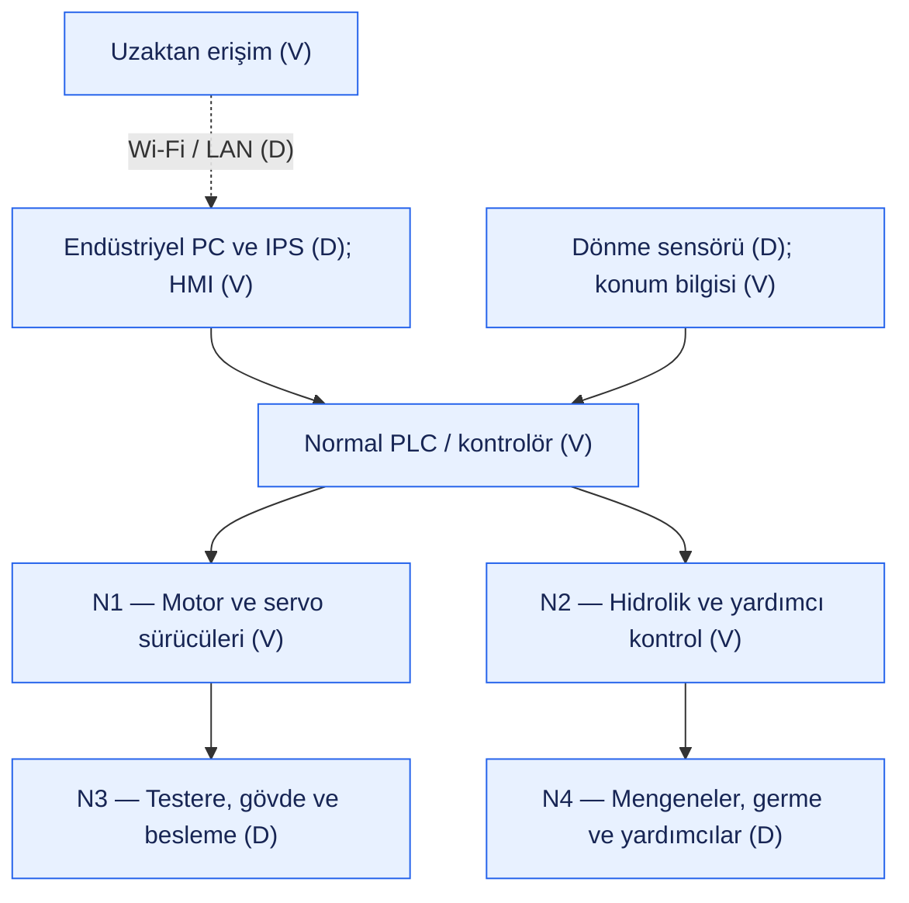
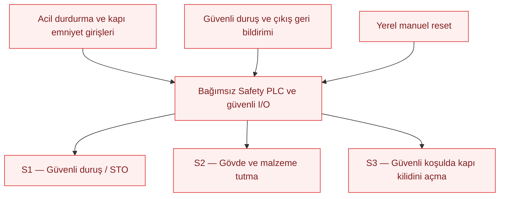

# VEGA 650×650 S-LINE — Normal kontrol ve safety mimarisi

Bu şema, açık kaynak bilgileri ve açıkça belirtilmiş varsayımlarla oluşturulan eğitim amaçlı kör analiz modelidir. Karmetal'in gerçek elektrik, hidrolik veya ağ şeması değildir. İlk çalışma kağıdındaki sorulara geçmeden önce ortak sistem modelini tanımlar.

**D:** Üretici bilgisinde doğrulanan özellik. **V:** Bu çalışma için kabul edilen varsayım. Bir bileşenin doğrulanması, aşağıdaki bağlantılarının veya safety yeteneğinin de doğrulandığı anlamına gelmez.

## Sistem şeması

Mavi: normal üretim kontrolü. Kırmızı: varsayılan safety yolu. Kesikli oklar: erişim veya izleme bağlantıları; safety durdurma kararı bu bağlantılara bağlı değildir. Oklar işlevsel ilişkilerdir, kablolama projesi değildir.

### Normal kontrol yolu

### Safety yolu — tamamı varsayım

### İki yol arasındaki bağlantılar

Uzun ve kesişen oklar yerine bağlantılar aşağıdaki tabloda gösterilmiştir. N1–N4 ve S1–S3, aynı makinenin yukarıdaki bloklarına verilen referanslardır; ek donanım değildir.

| Safety çıkışı | Etkilediği blok | İşlev |
|---|---|---|
| S1 — Güvenli duruş / STO | N1 — Motor ve servo sürücüleri | Normal komutlardan üstün güvenli duruş. |
| S2 — Gövde ve malzeme tutma | N3 — Gövde; N4 — Hidrolik tutma elemanları | Gövdenin düşmesini ve malzemenin tehlikeli biçimde bırakılmasını önleme; N2'nin normal komutlarından bağımsız güvenlik etkisi. |
| S3 — Kapı kilidi kumandası | Kabin kapısı emniyet kilidi | Güvenli erişim koşulu sağlanınca kilidi açma. |
| Safety PLC durum çıkışı | Normal PLC / kontrolör | Yalnız durum ve alarm aktarımı; durdurma için onay beklenmez. |

Acil durdurma ve kapı girişleri, çizimi sade tutmak için aynı kutuda gösterilmiştir; ayrı güvenli girişler olarak değerlendirilir. N4 içindeki soğutma ve talaş konveyörü yardımcı sistemlerdir; S2'nin tutma işlevi hidrolik tutma elemanlarına yöneliktir.

## Doğrulanan temel

Ürün sayfası endüstriyel bilgisayar, IPS akıllı kesim, servo gövde hareketi, servo malzeme sürme, hidrolik mengeneler ve şerit germe, kabin, temassız dönme sensörü, soğutma ve talaş konveyörünü belirtir. Wi-Fi uzaktan bağlantısı ürün sayfasında, LAN bağlantısı ayrıca üreticinin model tanıtımında yer alır. Uzaktan erişimin protokolü, yetkileri ve internet üzerinden erişilebilirliği bilinmemektedir.

## Mimari varsayımları

| Kod | Kabul | Sınır |
|---|---|---|
| V01 | Endüstriyel PC operatör arayüzü olarak standart PLC/kontrolörle haberleşir. | Ayrı PLC'nin varlığı, marka/modeli ve protokolü doğrulanmadı. |
| V02 | Standart kontrolör sürücüleri ve hidrolik/yardımcı çıkışları yönetir; proses geri bildirimini alır. | Kesin I/O listesi ve bağlantılar bilinmiyor. |
| V03 | Ayrı Safety PLC ve güvenli I/O, çift kanallı acil durdurmayı ve kabin kapısı kilidini değerlendirir. | Kabin doğrulandı; kilit, Safety PLC ve çift kanal yapısı varsayımdır. |
| V04 | İlgili sürücüler güvenli duruş ve STO işlevlerini destekler. | Gerçek sürücü işlevleri ve duruş süreleri doğrulanmadı. |
| V05 | Gövde için uygun yük tutma/frenleme, hidrolikte tehlikeli hareketi engelleyip gerekli malzeme tutmasını koruyan düzen vardır. | Gerçek fren ve valf tasarımı bilinmiyor; bu işlev modelin kabulüdür. |
| V06 | Safety sistemi güvenli duruş ve çıkış geri bildirimlerini izler; erişim ancak tehlike giderildiğinde serbest bırakılır. | Proses dönme sensörünün safety sertifikalı olduğu varsayılmaz; gerekli safety geri bildirimi ayrıca modellenir. |
| V07 | Reset yereldir; reset işlemi üretimi kendiliğinden başlatmaz. | Yeniden çalıştırmak için ayrıca operatör başlatma komutu gerekir. |
| V08 | Safety karar yolu standart PLC, HMI ve uzaktan bağlantıdan bağımsızdır; PLC'ye yalnız durum aktarılır. | Gerçek ağ izolasyonu veya siber saldırılara bağışıklık iddiası değildir. Safety programlama erişimi sonraki haftalarda V10/V15 ve C07 üzerinden ayrıca modellenmiştir; bkz. ortak kabuller ve Hafta 2. |

## Şemanın okunması

**Normal yol:** Operatör endüstriyel bilgisayardan üretim ayarlarını girer. Varsayılan standart kontrolör, sensör geri bildirimleriyle kesimi, beslemeyi ve yardımcı sistemleri yönetir.

**Safety yolu:** Acil durdurma veya kapı emniyet koşulunun kaybı, normal PLC/HMI onayı gerektirmeden Safety PLC tarafından değerlendirilir. Safety çıkışları ilgili sürücülerin güvenli duruşunu ve yük/malzeme tutmasını sağlar. Kabin kilidi tehlikeli hareket bitmeden açılmaz. Bu, varsayılan işlevsel davranıştır; gerçek duruş sırası ve süreleri saha doğrulaması gerektirir.

**Güvenli durumun modeldeki karşılığı:** Tehlikeli testere ve besleme hareketleri durmuştur; gövde düşmez; malzeme tehlikeli biçimde serbest kalmaz; beklenmedik yeniden başlatma engellenir. Hidrolik basıncın tamamını boşaltmak güvenli durum olarak kabul edilmez.

STO, motorun tork üretmesini engeller; tek başına anında durma, elektriksel izolasyon veya yerçekimine karşı yük tutma sağlamaz. Bu nedenle gövde tutma ve duruş izleme ayrıca gösterilmiştir. Duruş kategorisi, PL/SIL, tepki süresi veya uygunluk seviyesi bu kör analizde doğrulanmış sayılmaz.

## Kapsam

Bu dosya ilk haftada hazırlanan sistem modelidir; sonraki çalışma kağıtlarının cevapları ve risk puanları Hafta 2–4 dosyalarında tamamlanmıştır. SCADA, robot, ışık perdesi ve opsiyonel ICS bu başlangıç modeline eklenmemiştir. Uzaktan erişim için VPN/MFA bulunup bulunmadığı bilinmemektedir; mevcut kabul ve hedef önlemler Hafta 2 ve Hafta 4 dosyalarında ayrıca ele alınmıştır.

## Kaynaklar

Erişim tarihi: 23 Ekim 2026.

1. [Karmetal — VEGA 650×650 S-LINE ürün sayfası](https://www.karmetal.com.tr/urun/45/vega-650x650-s-line.html): doğrulanan makine bileşenleri.
2. [Karmetal — S-LINE model tanıtımı](https://www.karmetal.com.tr/haber/4/vega-650x650-s-line.html): Wi-Fi/LAN ve otomatik parametre ayarı.
3. [Siemens — Hanging loads with SIMATIC Axis technology object and SINAMICS, bölüm 2.4](https://cache.industry.siemens.com/dl/files/260/109807260/att_1104659/v1/109807260_HangingAxis_DOC_v11_en.pdf): STO ve yerçekimi etkisindeki eksenler için genel teknik dayanak; VEGA'nın Siemens kullandığının kanıtı değildir.

