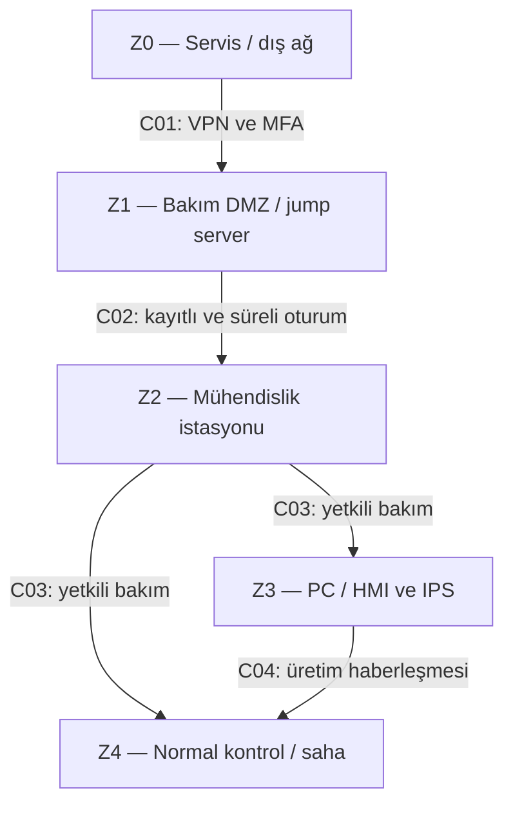
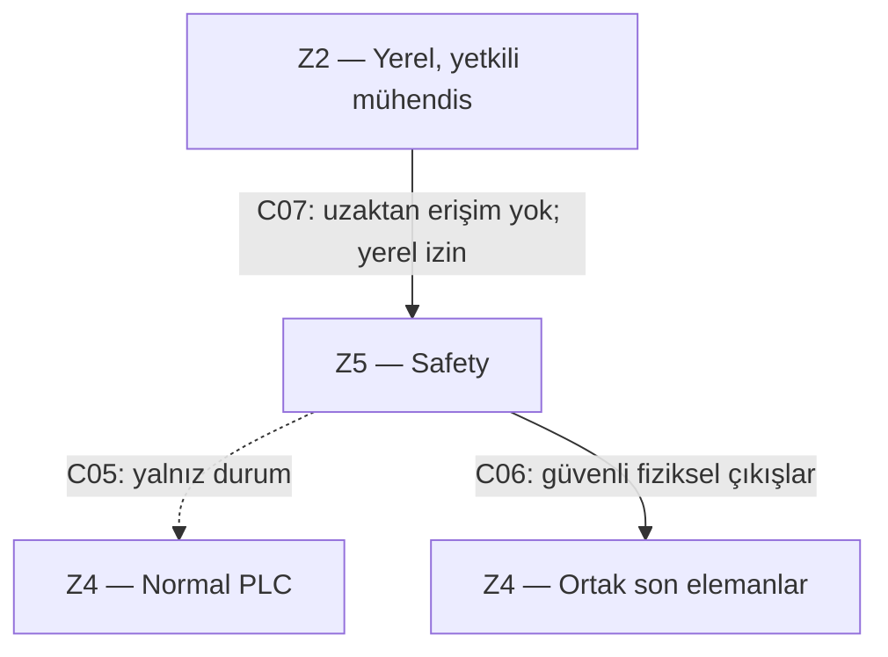

# Hafta 2 — Varlıklar, Zone / Conduit ve uzak erişim kararı

**Makine:** VEGA 650×650 S-LINE  
**Şablon:** T02 — 193127  
**Durum:** Doldurulmuş tasarım çalışması; sahada uygulanmış/test edilmiş değildir.  
**Ön okuma:** [Ortak kabuller](00-kapsam-kaynaklar-varsayimlar.md), [normal/safety şeması](01-sistem-semasi.md).

**Kavram:** Zone, benzer güvenlik ihtiyacı ve güven ilişkisi olan varlıkların bölgesidir. Conduit, bölgeler arasındaki ortak güvenlik gereksinimlerine sahip haberleşme kanallarının grubudur. Aynı VLAN'da olmak tek başına yeterli sınır değildir; geçişi uygulayan kurallar gerekir. Bu çalışma K03 yaklaşımını kullanır, sertifikalı IEC 62443 uygunluk iddiası taşımaz.

## Görev A — Varlıkları bölgelere ayırın

### A1. Hangi varlıklar aynı bölgede? Bölgeleri adlandırıp gruplandırın.

Aşağıdaki tablo **hedef gruplamadır (H)**. Başlangıç senaryosunda V09–V15 nedeniyle bu sınırlar yeterince uygulanmamaktadır.

| Zone | Varlık kodu ve içerik | Neden bu grupta? |
|---|---|---|
| Z0 — Dış ağ / servis | A01 servis sağlayıcı bilgisayarı, internet ve kurumsal kullanıcı ağı | Makinenin kontrol ettiği güven alanı dışında; doğrulanmadan güvenilmez. |
| Z1 — Bakım DMZ | A02 VPN/MFA erişim kapısı; A03 jump server ve oturum kayıt bileşeni | Dış bağlantı burada sonlanır. OT'ye doğrudan rota verilmez. Bunlar hedef eklemeleridir. |
| Z2 — Mühendislik / bakım | A04 mühendislik istasyonu ve onaylı proje/yedekler | Programlama yetkisi üretim kullanıcısından daha güçlüdür; HMI ile aynı güven alanında olmamalıdır. |
| Z3 — Operatör arayüzü | A05 endüstriyel PC/HMI ve IPS kütüphanesi; A06 Wi-Fi erişim altyapısı | Operatör etkileşimi ve reçete yönetimi. AP'nin yönetimi ayrıca kısıtlanır; misafir/servis kablosuzu OT'ye köprülenmez. |
| Z4 — Normal kontrol ve saha | A07 normal PLC; A08 sürücüler; A09 proses sensörleri; A10 hidrolik/yardımcı çıkışlar | Aynı üretim işlevine hizmet eder. Analog/dijital saha bağlantıları ağ cihazı sayılmaz; bu zone işlevsel saha kapsamını da içerir. |
| Z5 — Safety | A11 Safety PLC/güvenli I/O; A12 acil durdurma, kapı kilidi, safety geri bildirimleri, STO ve güvenli tutma elemanları | İnsan güvenliği işlevi; üretim/bakım yetkileri buraya serbestçe taşınamaz. Bazı son elemanlar normal yolla ortaktır, safety kumanda sınırı ayrıdır. |
| Z6 — Dış telemetri, koşullu | A13 bulut hizmeti, yalnız V14 gerçekleşirse; veri aktarma aracısı Z1'de | Bulut doğrulanmış değil. Kullanılacaksa yalnız gerekli veriyi dışarı verme; PLC/safety komutu yok. Temel kurulumda bu zone ve conduit kapalıdır. |

**Şablondaki özel varlıkların karşılığı:**

| Şablondaki öğe | VEGA için karar |
|---|---|
| Üretim PLC ve motor sürücüleri | A07–A08 / Z4, V01–V02. |
| Emniyet PLC'si | A11 / Z5, V03. |
| Port 80 HMI | A05 / Z3; HTTP arayüzü V11'dir. Gerekmiyorsa kapatılır; gerekiyorsa üretici destekli güvenli erişimle sınırlandırılır. HTTPS yoksa zayıf servisi internete açmak yerine güvenli aracı ve ağ kısıtı kullanılır. |
| İnternete açık uzak bakım modülü | Başlangıçta A05/A04'e doğrudan yol V09'dur. Hedefte erişim Z1'de sonlandırılır. |
| Wi-Fi AP, görünür parola | A06 / Z3, V13; ayrı misafir ağı, güçlü kimlik doğrulama ve yönetim kısıtı hedeflenir. Parola değiştirmek tek başına yeterli değildir. |
| İki kilitsiz USB | A05/A04'e bağlı fiziksel girişler, V12. Portlar ayrı zone değil; bu varlıklara yönelik veri/zararlı yazılım girişidir. Yetkili cihaz ve dosya kabulü uygulanır. |
| “admin/admin” hesabı | Bir cihaz değil, A04/A05'e erişimi etkileyen kimlik bilgisi zayıflığı, V11. Gerçek parola olarak ileri sürülmez. |
| Bulut telemetri | A13 / Z6 yalnız koşullu; doğrulanmadığından ana makineye eklenmez. |

### A2. Açık uzak bakım modülü hangi bölgeye düşüyor; orada kalabilir mi? Neden?

Başlangıç kabulünde servis erişimi doğrudan HMI veya mühendislik istasyonuna açıldığı için dış ağın Z3/Z2'ye kontrolsüz geçişidir. “Modül bakım içindir” diyerek güvenilir üretim zone'una yerleştirmek doğru değildir. Bu şekilde kalamaz: ele geçirilen servis hesabı üretim ayarı değiştirmeye ve V10 mevcutsa safety projesinin bakım yoluna ulaşmaya zemin hazırlar.

Hedefte dış bağlantı **Z1 bakım DMZ'sindeki VPN/MFA kapısında sonlanır**; jump server üzerinden yalnız onaylı hedefe geçilir. Eski modül ancak üretici desteğiyle doğrudan dış erişimi ve köprüleme yeteneği kaldırılıp bu kurallara uydurulursa yeniden kullanılabilir. Aksi durumda değiştirilir/devreden çıkarılır. Sadece IP adresini başka VLAN'a taşımak yeterli değildir.

### A3. Bölgeler arası geçişler nerede? Her geçişte ne kontrol edilecek?

| Kod | Kaynak → hedef ve işlev | İzin / kontrol | İzin verilmeyen |
|---|---|---|---|
| C01 | Z0 → Z1; VPN oturum kuruluşu | Kişisel hesap, MFA, yönetilen servis cihazı, onaylı talep, süre sınırı; kimlik ve bağlantı kaydı. | İnternetten HMI/PLC/engineering'e doğrudan erişim. |
| C02 | Z1 → Z2; jump server'dan bakım oturumu | Yalnız A03 → A04, onaylanan uzak masaüstü/uygulama protokolü, süreli kural, oturum kaydı; pano/dosya aktarımı varsayılan kapalı. | Tam OT ağına tünel veya genel yönlendirme. |
| C03 | Z2 → Z3/Z4; bakım ve proje değişikliği | Hedef IP/servis/rol bazlı izin; normal teşhis ile program yazma ayrı yetki; yazma için yerel onay, yedek ve değişiklik kaydı. | Geniş “any-any” kuralı; üretim sırasında kontrolsüz program indirme. |
| C04 | Z3 → Z4; HMI–PLC üretim haberleşmesi | Yalnız gereken cihaz çifti ve üretici protokolü; operatör yetkisi, reçete sürümü ve parametre sınırları. | HMI'dan safety program yazma; protokolü bilinmeden her portu açma. |
| C05 | Z5 → Z4; safety durum aktarımı | Hedef modelde salt durum/alarm; PLC'ye giden sınırlı, tercihen fiziksel durum çıkışları. | Normal PLC'nin bu kanaldan safety reset, bypass veya proje yazması. |
| C06 | Z5 → Z4 son elemanları; güvenli duruş/tutma | Ağ yönlendirmesi değil güvenli I/O/STO/fren-valf bağlantısı olarak modellenir; kanal/çıkış geri bildirimi ve safety doğrulaması gerekir. | Güvenli durdurmanın HMI mesajı veya firewall yanıtına bağımlı olması. |
| C07 | Z2 → Z5; safety bakım/yazma | Uzaktan oturum varken kapalı. Yalnız yerel yetkili bakım, fiziksel bakım izni, iki kişiyle değişiklik onayı, sürüm kontrolü ve yeniden doğrulama. | Jump server veya HMI üzerinden safety programlama. |
| C08 | Z1 → Z6; isteğe bağlı telemetri | Varsayılan kapalı; açılırsa DMZ aracısından sınırlı dışa veri, kimliği doğrulanmış şifreli bağlantı ve kayıt. | Buluttan PLC veya Safety PLC'ye komut/yazma. |

Port/protokol envanteri doğrulanmadığı için PLC/safety markası ve endüstriyel port numarası uydurulmamıştır. Uygulamada allowlist, üretici dokümanı ve testle somutlaştırılmalıdır. Safety protokolünün hata tespiti yapması, kendiliğinden siber erişim kontrolü sağladığı anlamına gelmez.

### Zone / conduit şeması — hedef

Çizgi karmaşasını azaltmak için normal erişim ve safety sınırı iki ayrı çizimde gösterilmiştir. C03, iki hedefe izin verebilen **ayrı ayrı sınırlandırılmış** bakım kanallarının grubudur.

Ağdaki bir yayın veya internet kesintisi C06'yı taşımamalıdır. Bu eğitim modelinde C06 fiziksel güvenli I/O'dur; kablolama ve performans doğrulaması yapılmış değildir. Z6 koşullu olduğundan ana çizime eklenmemiştir.

## Görev B — Uzak erişim kararı, altı satır

| Karar | Seçim | VEGA için gerekçe |
|---|---|---|
| Araç | **Jump server** | Servis bilgisayarı PLC/HMI'ya doğrudan bağlanmaz; hedef ve oturum merkezi olarak sınırlandırılır. |
| Tünel | **VPN** | Dış bağlantı Z1'de kimliği doğrulanmış ve şifreli olarak sonlanır; tam ağ erişimi verilmez. |
| Kimlik | **MFA** | Parolanın ele geçirilmesi tek başına giriş için yeterli olmamalıdır. |
| Hesap | **Kişisel, rol bazlı** | Ortak hesap kaldırılır; kimin ne yaptığı izlenebilir, safety yetkisi normal bakım hesabına verilmez. |
| Kayıt | **Tam oturum ve değişiklik kaydı** | Giriş/çıkış, hedef, talep numarası, dosya aktarımı ve proje değişikliği ilişkilendirilir; sırlar maskelenir. |
| Zamanlama | **Varsayılan kapalı, onaylı süreli erişim** | Yerel sorumlu açar; süre dolunca oturum ve geçiş kuralları kapanır. Acil kesme imkânı bulunur. |

## Teslim çıktısı ve bağlantı

Bu dosya **Zone / Conduit Diagram → EP-05** çıktısıdır. Başlangıç zayıflıklarının riskleri [Hafta 3](03-hafta-risk-degerlendirmesi.md), erişim kararlarının uygulanabilir hedef akışı [Hafta 4](04-hafta-guvenli-uzaktan-erisim.md) içinde işlenmiştir.
