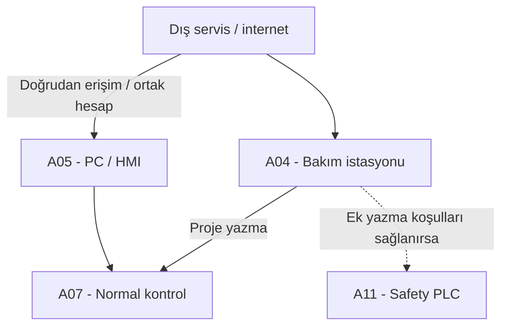
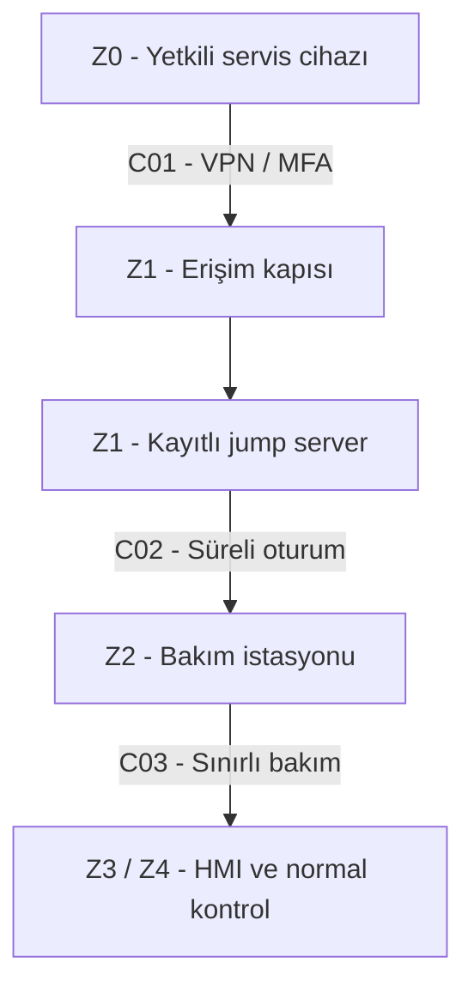

# Hafta 4 - Güvenli uzaktan erişim

**Şablon:** T04 / 193213. **Makine:** VEGA 650×650 S-LINE. **Tarih:** 25 Ekim 2026.

[Ortak kabuller](00-kapsam-kaynaklar-varsayimlar.md), [zone/conduit](02-hafta-zone-conduit.md) ve [risk kaydı](03-hafta-risk-degerlendirmesi.md) birlikte geçerlidir. Üretici Wi-Fi/LAN bağlantısını belirtir; internete açıklık ve ortak hesap şablonu uygulamak için varsayılmıştır.

## Görev A - Mevcut → hedef

### Mevcut - analiz başlangıcı

V09–V15 kapsamında MFA, süreli onay ve yeterli kayıt/segmentasyon olmadığı kabul edilir. Safety programlama yolu üretim komutundan ayrıdır fakat yeterince korunmamıştır. A04'ün ele geçirilmesi safety yazma için tek başına yeterli değildir; R02/R03'ün ek koşulları gerekir. Normal PLC'nin safety kararını doğrudan iptal ettiği varsayılmaz.

### Hedef - beş ilkeyle yeniden tasarım

VPN ve MFA aynı güvenli giriş ilkesi altında birleştirilmiştir; Hafta 2'deki altı karar korunur.

| İlke | VEGA hedefi | Yol / önlem |
|---|---|---|
| 1. Ara nokta ve segmentasyon | Dış bağlantı Z1 bakım DMZ'sinde sonlanır; jump server yalnız onaylı A04 oturumuna geçer. HMI/PLC'ye doğrudan internet rotası kaldırılır. | C01–C03 / H01. |
| 2. Güvenli tünel ve kimlik | VPN, MFA, yönetilen servis cihazı; yalnız onaylı hedef/servis. VPN tam OT erişimi değildir. | C01–C02 / H01. |
| 3. Kişisel sınırlı yetki | Ortak hesap kaldırılır; teşhis, normal proje yazma ve safety değişikliği ayrılır. Uzak kullanıcıya safety yazma/reset/bypass verilmez. | C03/C07 / H05–H08. |
| 4. Kayıt ve izlenebilirlik | Kullanıcı, talep, hedef, zaman, oturum ve dosya/proje değişikliği ilişkilendirilir; kayıtlar korunur ve saatler eşleştirilir. | C01–C03 / H01/H07. |
| 5. Varsayılan kapalı erişim | Yerel sorumlu süreli bakım penceresini açar; bitişte oturum ve geçici izinler kapanır. Yerel bağlantı kesme imkânı vardır. | C01–C03 / H01/H05. |

Safety'ye uzak programlama rotası yoktur. C07 ayrı yerel bakım işlemidir. Aynı A04 uzaktan yönetilirken yerel safety yazma yolu açık bırakılamaz: hesap kısıtına ek fiziksel bağlantı/izin veya eşdeğer teknik ayrım gerekir. Kişinin tesiste bulunması, bilgisayarın uzak kullanıcı tarafından yönetilmediğini kanıtlamaz.

### Oturumun işleyişi

1. Talepte hedef cihaz, arıza, gereken yetki ve süre yazılır; yerel sorumlu makinenin durumunu değerlendirir.
2. Teşhis salt okunur başlar. Hareketi etkileyen test/proje değişikliği ayrıca yerel onay ve güvenli makine durumu gerektirir; bağlantı izni hareket izni değildir.
3. VPN/MFA ile Z1'e girilir; jump server yalnız onaylı oturumu açar. Dosya aktarımı varsayılan kapalıdır; gerekirse ayrıca kontrol edilir ve kaydedilir.
4. Normal kontrol değişikliğinden önce proje yedeği, sürüm ve geri dönüş planı alınır. IPS değişikliği H02 onayına tabidir. Safety değişikliği istenirse uzak yazma yapılmaz, ayrı yerel süreç başlatılır.
5. Yerel personel sonucu kontrol eder; üretime dönüş ayrıca onaylanır. Reset makineyi kendiliğinden çalıştırmaz.
6. Süre sonunda oturum/izinler kapanır; kayıtlar talebe bağlanır. Şüphede uzak erişim kesilir, fiziksel güvenlik ayrıca kontrol edilir.

**Bağlantı kaybı:** Beklenmedik hareket başlatmamalıdır. Üretimin devamı veya kontrollü duruş yerel kontrol tasarımında tanımlanır; her internet kesintisi otomatik acil duruş değildir. Yerel safety her durumda korunmalıdır.

## Görev B - Functional safety köprüsü

### B1. Saldırgan bütün önlemlere rağmen içeri girerse emniyet fonksiyonu etkilenir mi? Neden?

Hedefte **yalnız PC/HMI veya normal PLC'nin ele geçirilmesi safety işlevini geçersiz kılamamalıdır**. Acil durdurma ve kapı girişlerini A11 değerlendirir; C06 üzerinden duruş, gövde/malzeme tutma ve kilit yönetimi normal PLC/HMI onayı beklemeden uygulanır. Normal çalıştır komutu bu kararı aşamaz; C05 yalnız durum aktarır.

Bu, mutlak bağışıklık değildir. Safety projesi, güvenli sürücü ayarı veya son eleman yetkisiz değiştirilirse R02/R03 oluşabilir. C07 bu nedenle uzaktan kapalıdır; yerel yazma ve yeniden doğrulama ayrıca korunur. Ortak güç, sürücü, kablolama ve tutma bağımlılıkları da incelenmelidir. Gerçek devre ve testler olmadan işlevin sağlandığı kanıtlanamaz; burada hedef davranış tanımlanmaktadır.

### B2. Uzak bakımdan etkilenmemesi için üç gereksinim yazın

Gereksinimler çözüm adı yerine sınanabilir davranış olarak yazılmıştır. Testler yetkili ve kontrollü ortamda planlanır; bu çalışmada yapılmamıştır.

| Kod | Gereksinim | Kabul ölçütü / doğrulama |
|---|---|---|
| FS-01 - Bağımsız karar | Uzak bağlantı varlığı/kaybı, PC/normal PLC arızası veya geçersiz komutu, acil durdurma ve kapı talebinin güvenli duruma ulaşmasını engellememelidir. Safety uzak onay beklememelidir. | Devre/I/O incelemesi ve kontrollü arıza testinde hareket durur, gövde/malzeme tutulur. Tepki süreleri ayrıntılı risk analizinde belirlenecek sınırlar içinde ölçülür; burada süre uydurulmaz. |
| FS-02 - Değişiklik sınırı | Uzak kullanıcı ve ele geçirdiği istasyon safety programı, güvenli sürücü parametresi, bypass veya reset durumunu değiştirememelidir. Safety değişikliği ayrı yerel izin ve yeniden doğrulama gerektirmelidir. | Bütün yazma yolları incelenir; kontrollü ortamda uzak yazma/bypass reddedilir ve kaydedilir. Yerel değişiklik için onay, önce/sonra proje kimliği ve doğrulama raporu bulunur. |
| FS-03 - Tutma ve yeniden başlama | Safety talebi/hata sonrası tehlikeli hareket önlenmeli; gövde düşmemeli, malzeme tehlikeli bırakılmamalı, tehlike sürerken kapı açılmamalıdır. Bağlantının geri gelmesi/reset tek başına üretim başlatmamalıdır. | Tanımlı yüklerde tutma/kapı/geri bildirim sırası doğrulanır. Reset ve bağlantı geri gelme testlerinde hareket başlamaz; ayrı yerel başlatma gerekir. Bakım izolasyonu ayrıca doğrulanır. |

PLr/SIL, duruş kategorisi ve test kapsamı ayrıntılı makine risk değerlendirmesinde ayrıca belirlenir. Ağ önlemleri safety doğrulamasının yerine geçmez.

**Çıktı:** EP-02 + EP-06. Dayanak K04; bağlantı temeli K01–K02. [Kanıt planı](05-izlenebilirlik-ve-kanit-plani.md).
